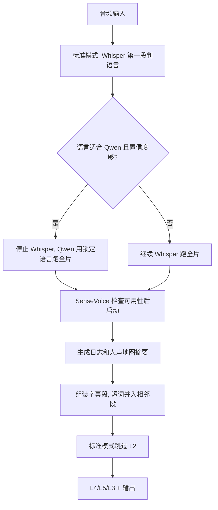

# P276/P277/P278/P279/P281 标准模式测试问题修复流水线 — 2026-06-16

## 元信息
- 涉及问题：P276, P277, P278, P279, P281（P280 已并入 P277/P278；P282 后续单独做环境归档）
- 涉及文件：`v2/backend/transcriber_v2.py`, `v2/backend/worker.py`, `v2/backend/main.py`, `v2/backend/core/hallucination_filter.py`
- 当前进度：①/⑩

## ① investigate — 2026-06-16
**执行人**：Codex
**依赖类型**：📖 读指定文件
**读了什么**：
- `/Users/andy/.video-subber/logs/79066a0965/user.log:6-68`
- `/Users/andy/.video-subber/logs/e5494b352d/user.log:125-164`
- `v2/backend/transcriber_v2.py:668-1009`
- `v2/backend/core/qwen_asr_runner.py:68-72,252-291`
- `v2/backend/core/sensevoice_runner.py:25-30,60-78,143-199`
- `v2/backend/worker_manager.py:44-53`

### 结论（下一步只看这里）
这次真实标准模式 run `79066a0965` 暴露五个底层问题，不能只按 P276 处理。

1. P276：标准模式模型路由错误。标准版应该先用 Whisper 第一段当语言检测模型，再决定继续 Whisper 还是切 Qwen；当前是 Qwen 在 `source_lang=auto` 时直接跑完整片。最新 run 的 transcript 混入中文、英文和日文，Qwen 小 segments 合计 1947，低于对照 run `e5494b352d` 的 2776。
2. P277：环境证据显示 `v2/.venv/bin/python` 可以 import `funasr`，项目根 `.venv/bin/python` 和系统 Python 不能。`worker_manager.py` 用 `sys.executable` 启动 worker，所以 uvicorn 用错 Python 时，worker 会继承错误环境，SenseVoice 可能静默不可用。
3. P278：最新 run 只出现“并行模式：SenseVoice”日志，但没有 `加载 SenseVoice 模型`、`SenseVoice 分段处理完成`、人声地图摘要、L1 输入数量，说明日志既少又容易误导。
4. P279：标准模式没有完整第二稿，L2 不应继续输出 `NO_QWEN/EMPTY` 统计，应明确跳过交叉验证。
5. P281：单字“好/吧/十”属于切句和字幕重组问题。当前缺少“说话区短切片 → ASR → 对齐 → 字幕重组”的流程，导致短音节或短词容易独立成字幕。

P280 归类修正：最新 run 没有 `P275 人声地图`、`voice_regions/non_voice_regions` 摘要，也没有 `L1 SV误判清除`，所以这次不能证明 L1/SenseVoice 实际生效。但这不是独立根因，而是 P277 启动环境和 P278 日志的验收项。

P282 归类边界：项目环境和历史文件归档不是本轮功能性 bug 修复的一部分。P277 负责运行时用对 Python；P282 在修复和真实重跑后单独整理 `.venv`、历史报告、临时数据库和旧目录。

修复方案：
- 统一启动环境到 `v2/.venv`，并在服务/worker 日志打印 Python 路径。
- 标准模式先用 Whisper 语言检测结果做路由：中/日/韩/英且概率足够时切到 Qwen，并把锁定语言传给 Qwen；其他语言继续 Whisper 主引擎。
- SenseVoice 日志后移到可用性检查之后，不可用时明确写出当前 Python 无法 import `funasr`。
- 标准模式单主引擎时明确跳过 L2。
- P281 先做最小止血：字幕重组阶段禁止明显单字/短词轻易独立成句，能并入同一说话区相邻句就并入；完整 VAD/SenseVoice 短切片方案另走设计。

### 涉及文件列表
- `v2/backend/worker_manager.py:44-53` — worker 使用 `sys.executable` 继承 uvicorn Python。
- `v2/backend/worker.py:71-124` — 每个 job 的文件日志初始化位置，适合打印 Worker Python。
- `v2/backend/main.py:228-252` — FastAPI startup，适合打印 Server Python。
- `v2/backend/transcriber_v2.py:672-805` — 标准/精确模式主引擎选择与 Qwen/Whisper 启动。
- `v2/backend/transcriber_v2.py:839-884` — SenseVoice 启动日志和可用性检查。
- `v2/backend/transcriber_v2.py:1002-1009` — 过滤器入口，标准模式应跳过 L2。
- `v2/backend/core/hallucination_filter.py:760-764` — L2 调用入口，应支持无 Qwen 交叉稿时跳过。

### 关键代码
```python
# worker_manager.py
proc = subprocess.Popen(
    [sys.executable, "-m", worker_module, str(config_path)],
    ...
)
```

```python
# transcriber_v2.py
lang = None if source_lang == "auto" else source_lang
detected_lang = source_lang
...
_qwen_holder["data"] = run_qwen_asr(audio_path, language=detected_lang)
```

## ② 双签审查（plan-eng-review + steve-jobs-perspective）— 2026-06-16
**执行人**：Codex
**依赖类型**：📋 看记录
**前置阅读**：① investigate 结论；本步不重新读代码。

### 结论（下一步只看这里）
五个问题的边界成立，但修复必须分清“本轮功能修复”和“后续环境归档”。

#### 工程审查结论
1. P276 修法正确：标准模式不能把 `auto` 直接交给 Qwen。应先用 Whisper 第一段做语言判断，再决定继续 Whisper 或切 Qwen。这里 Whisper 的角色是“语言检测器”，不是一定要跑完整片。
2. P277 修法必须聚焦运行链路：确认 server/worker 都用 `v2/.venv`，并把 Python 路径写入日志。它不负责清理两个虚拟环境和历史文件；那些归 P282。
3. P278 修法必须让日志从“猜测”变成“证据”：SenseVoice 可用、启动、完成、跳过、失败、人声地图摘要都要明确写出。
4. P279 修法清楚：标准模式只有一个主稿，没有第二稿时直接跳过 L2。不要再生成空窗口、低证据、无参考稿这类假问号。
5. P281 方向正确，但要拆两层：本轮先做“单字/短词不轻易独立成字幕”的止血修复；完整 WhisperJAV 式流程（场景切分 + VAD + SenseVoice + ASR + 对齐 + 重组）属于架构级改造，必须先设计再大改。

#### 产品审查结论
本轮最重要的是恢复用户能感知的可信结果，不要一次把系统重写成竞品架构。

应该保留：
- Whisper 第一段判语言，因为它直接解决本轮 Qwen 猜错语言的问题。
- SenseVoice 日志和人声地图摘要，因为用户需要知道 L1 到底有没有生效。
- 标准模式跳过 L2，因为没有第二稿时继续跑 L2 是假严谨。
- 单字短词合并，因为它直接对应用户看到的“好/吧”问题。

暂时不要做：
- 不要把 VAD 变成硬过滤器。VAD 只生成候选说话区，不直接删字幕，避免重演旧 VAD 误删历史。
- 不要在本轮清理/删除虚拟环境和历史文件。先修功能，真实重跑确认，再按 P282 单独整理。
- 不要把 P281 的完整竞品式流水线塞进一次补丁。先做设计图和最小止血，后续再做架构迁移。

### 审查决定
通过，但执行顺序调整为：
1. 先修 P276/P277/P278/P279，这四个是当前标准模式跑错的基础链路。
2. P281 本轮只做最小止血：短词/单字合并规则和可观测统计；完整 VAD/SenseVoice 短切片方案进入设计，不直接大改主链路。
3. P282 明确延后：等真实重跑通过后，再归档虚拟环境、历史报告和临时文件。

### 涉及文件列表
- `pipelines/bug-pipeline-2026-06-16-p276-standard-language-env.md` — 本步只基于①结论审查，不新增代码文件阅读。

### 关键代码
本步不读代码、不改代码。

## ③ 双签影响面（ln-021-codegraph + bill-gates）— 2026-06-16
**执行人**：Codex
**依赖类型**：📖🌐 读全项目
**读了什么**：
- `v2/backend/transcriber_v2.py:665-1050`
- `v2/backend/worker.py:494-521,535-540,733-748`
- `v2/backend/core/hallucination_filter.py:720-767`
- `v2/backend/core/qwen_asr_runner.py:280-291`
- `v2/backend/core/qwen_aligner.py:176-279`
- `v2/backend/core/sentence_splitter.py:83,185,274`
- `v2/backend/core/subtitler.py:89`
- `v2/test/test_p273_qwen_ja_assembly.py`
- `v2/test/test_p276_standard_language_env.py`

### 结论（下一步只看这里）
影响面集中在转录编排层，不需要全项目重写。

#### 调用链
用户上传视频后，真实链路是：
`worker.py` 调 `transcribe_v2()` → `transcriber_v2.py:transcribe()` 决定 Qwen/Whisper/SenseVoice/FA → `_smart_assemble()` 组装字幕段 → `filter_hallucinations()` 做 L1/L2/L3/L4 → `worker.py` 翻译和生成字幕。

#### P276 影响面
- 主要改 `transcriber_v2.py:665-855`。
- 风险：标准模式先跑 Whisper 第一段时，不能又恢复成精确模式双引擎全量跑，否则标准模式成本会上升。
- 约束：Whisper 第一段只拿语言判断；如果切 Qwen，要释放 Whisper 迭代器/模型引用，避免双模型长期占内存。

#### P277 影响面
- 主要改 `worker.py` 日志、`main.py` 启动日志、可能补启动文档。
- 风险：不要在本轮删除 `.venv` 或改变用户启动习惯太大。
- 约束：先增加可见证据，真实 run 前确认 server/worker Python 路径；P282 再处理目录归档。

#### P278 影响面
- 主要改 `transcriber_v2.py:880-940` 附近 SenseVoice 启动逻辑。
- 风险：日志不能只写“开始”，必须写“不可用/跳过/完成/返回事件数/人声地图摘要”。
- 约束：SenseVoice 不可用时不能静默跳过；也不能把“未运行”伪装成“无人声”。

#### P279 影响面
- 主要改 `filter_hallucinations()` 和 `transcriber_v2.py` 调用参数。
- 已有测试 `test_filter_hallucinations_can_skip_l2_when_no_second_signal` 指向正确方向。
- 风险：精确模式不能误跳 L2；标准模式必须明确跳过 L2。

#### P281 影响面
- 最小止血改 `_assemble_qwen_primary()` 或 `_smart_assemble()` 后的结果清理。
- 完整竞品式切片会影响 ASR 前置流程、SenseVoice/VAD、Qwen 输入、FA 对齐和字幕重组，属于更大架构，不在本轮直接落地。
- 约束：本轮可以加“短词/单字并入相邻段”的规则和统计；不要引入硬 VAD 删除。

#### 系统风险判断
从系统角度看，最大的风险不是单个函数写错，而是把“证据链”继续做成黑盒。修复后必须能从日志回答五个问题：
1. 标准模式最后选了 Whisper 还是 Qwen？
2. 选择依据是什么语言、多少置信度？
3. server/worker 分别用了哪个 Python？
4. SenseVoice 到底跑没跑、返回多少事件、人声地图多少段？
5. 标准模式是否明确跳过 L2？

### 审查决定
通过。第⑦步 TDD 要覆盖五类断言：
1. 标准模式路由函数：日语高置信度切 Qwen，低置信度/非主语言继续 Whisper。
2. 环境日志：worker/server Python 路径可见。
3. SenseVoice 不可用：日志明确写 FunASR/SenseVoice 不可用。
4. 标准模式 L2：明确跳过。
5. 单字短词：同一说话区内短词不单独成字幕。

### 涉及文件列表
- `v2/backend/transcriber_v2.py:665-1050` — 语言路由、SenseVoice、组装、过滤调用都在这里。
- `v2/backend/core/hallucination_filter.py:720-767` — L2 调用入口。
- `v2/backend/worker.py:494-521` — 调用 `transcribe_v2()`，适合验证真实 job 链路。
- `v2/backend/main.py` — 服务启动日志位置。
- `v2/test/test_p276_standard_language_env.py` — 当前红灯测试入口，需要扩展 P281。

### 关键代码
```python
# worker.py
segments = transcribe_v2(
    audio_path, model_size=model, source_lang="auto",
    skip_vad=False, filter_keywords=filter_keywords,
    transcription_tier=transcription_tier,
)
```

```python
# transcriber_v2.py
def transcribe(..., transcription_tier: str = "standard", ...):
    use_qwen = should_qwen_pipeline(transcription_tier, ram_gb)
    use_whisper = should_load_whisper(transcription_tier)
    ...
    results = filter_hallucinations(...)
```

## ④ 双签 diff + 简化（/review + elon-musk）— 2026-06-16
**执行人**：Codex
**依赖类型**：📖🌐 读全项目
**读了什么**：
- `git diff -- v2/backend/transcriber_v2.py v2/backend/worker.py v2/backend/core/hallucination_filter.py v2/test/test_p276_standard_language_env.py`

### 结论（下一步只看这里）
当前半成品 diff 方向对，但有 4 个必须在 TDD 实现阶段修掉的问题。

#### 发现 1：标准模式 Qwen 不可用时会回到已释放的 Whisper
位置：`v2/backend/transcriber_v2.py` 当前 diff 的标准模式路由段。

当前逻辑是：Whisper 检测到语言适合 Qwen → 删除 `segments_iter` 和 `model` → 尝试跑 Qwen → 如果 Qwen 不可用，把 `_standard_primary` 改回 `"whisper"`。  
问题是这时 Whisper 迭代器和模型已经释放了，后面不能再继续 Whisper。

决定：先确认 Qwen 可用，再释放 Whisper。或者如果已经释放，就不能再回退到 Whisper，只能抛出明确错误。本轮采用更稳的方式：先检查 Qwen 可用，确认可用后再释放 Whisper。

#### 发现 2：标准模式选 Whisper 时，后面仍可能被当成 Qwen 主引擎
位置：`v2/backend/transcriber_v2.py` 当前 diff 的主引擎选择段。

当前 `else` 分支只看 `use_whisper`，标准模式 `use_whisper=False` 时会默认 `_which_primary="qwen"`。但标准模式路由可能选择 `_standard_primary="whisper"`。这会导致后面的 L1、SenseVoice target、组装都按 Qwen 走。

决定：主引擎选择必须看 `_standard_primary`，不能只看 `use_whisper`。

#### 发现 3：`skip_l2` 参数加了，但调用处没传
位置：`v2/backend/core/hallucination_filter.py` 和 `v2/backend/transcriber_v2.py` 当前 diff。

`filter_hallucinations()` 已支持 `skip_l2=True`，但 `transcriber_v2.py` 调用时还没有传。这样 P279 不会真正生效。

决定：标准模式调用过滤器时传 `skip_l2=(transcription_tier == "standard")`。

#### 发现 4：文档注释仍有旧口径
位置：`v2/backend/transcriber_v2.py` 文件头和 `should_load_whisper()` 注释。

当前文件头写“标准模式 Qwen3-ASR sole engine, auto language detection”，这已经和 P276 新方案冲突。`should_load_whisper()` 也写“Whisper only loaded in precise mode”，但标准模式现在会加载 Whisper 做第一段语言检测。

决定：注释必须跟新方案一致，避免以后维护者再把 Whisper 从标准模式完全删掉。

### 简化结论
不要引入新的“大路由类”或重写 transcribe。最小修法是：
1. 保留 `choose_standard_primary_engine()` 这个小函数。
2. 在 `transcribe()` 内把标准模式分成两个清楚分支：`_standard_primary == "qwen"` 和 `_standard_primary == "whisper"`。
3. SenseVoice 日志只调整顺序和可见性，不新建复杂状态机。
4. P281 先加一个小的短词合并函数，不把完整 VAD 架构塞进本轮。

### 涉及文件列表
- `v2/backend/transcriber_v2.py` — 主要风险和主要修复点。
- `v2/backend/core/hallucination_filter.py` — `skip_l2` 参数已有，调用处需接上。
- `v2/backend/worker.py` — Worker Python 日志方向正确，风险低。
- `v2/test/test_p276_standard_language_env.py` — 红灯测试需要扩展 P281 和路由回退场景。

### 关键代码
```python
if _standard_primary == "qwen":
    del segments_iter
    del model
    ...
    if not is_qwen_asr_available():
        _standard_primary = "whisper"  # 这里已经没有可用 Whisper
```

```python
results = filter_hallucinations(..., skip_l1=(_which_primary == "qwen"))
# 缺少 skip_l2=(transcription_tier == "standard")
```

## ⑤ 设计一致性走查 — 2026-06-16
**执行人**：Codex
**依赖类型**：📖 读指定文件
**读了什么**：
- `v2/backend/transcriber_v2.py:665-1050`
- `v2/backend/core/hallucination_filter.py:720-767`

### 结论（下一步只看这里）
走查不通过，发现 3 个设计和代码错位点。必须在 TDD 修复阶段处理后，才能继续后面的验证。

### 设计图


### 逐步骤对照

| 设计步骤 | 代码对应 | 一致？ |
|---|---|---|
| Whisper 第一段判语言 | `transcriber_v2.py:723-749` | ✅ 基本一致 |
| 根据语言选择主引擎 | `transcriber_v2.py:751-771` | ⚠️ 部分一致，Qwen 不可用回退会用到已释放 Whisper |
| 主引擎贯穿后续流程 | `transcriber_v2.py:828-846` | ❌ 错位。代码用 `use_whisper` 判断，不看 `_standard_primary` |
| SenseVoice 先检查再写启动日志 | `transcriber_v2.py:880-888` | ❌ 错位。代码先写“并行模式”，再检查可用性 |
| 标准模式跳过 L2 | `hallucination_filter.py:760-767` + `transcriber_v2.py:1046-1050` | ❌ 少了。过滤器支持 `skip_l2`，调用处没传 |
| 单字短词合并 | 当前无明确代码 | ❌ 少了 |

### 数据流追踪

| 步骤 | 数据包 | 手（函数/代码段） | 读/改/扔 | 设计图上？ |
|---|---|---|---|---|
| Whisper 判语言 | `detected_lang`, `lang_probability` | `model.transcribe()` | 生成 | ✅ |
| 标准模式选择 | `_standard_primary` | `choose_standard_primary_engine()` | 生成 | ✅ |
| 后续主引擎 | `_which_primary` | `transcriber_v2.py:828-846` | 改 | ❌ 用了旧条件，丢了 `_standard_primary` |
| SenseVoice 证据 | `sv_events` | `is_sensevoice_available()` / `run_sensevoice()` | 生成或缺失 | ⚠️ 日志没把缺失写清楚 |
| L2 输入 | `qwen_chunks` | `filter_hallucinations()` | 读 | ❌ 标准模式应跳过，不应制造空参考稿 |
| 字幕段 | `results` | `_smart_assemble()` | 改 | ⚠️ 缺少短词合并规则 |

### 偏差汇总

| # | 类型 | 描述 | 决定 |
|---|---|---|---|
| 1 | 错位 | 标准模式路由选出的 `_standard_primary` 没有贯穿到 `_which_primary` | 修代码 |
| 2 | 错位 | SenseVoice 日志先于可用性检查 | 修代码 |
| 3 | 少了 | 标准模式调用过滤器时没有传 `skip_l2=True` | 修代码 |
| 4 | 少了 | 单字短词合并规则缺失 | 加最小止血函数 |

### 涉及文件列表
- `v2/backend/transcriber_v2.py:723-846` — 标准模式语言路由和主引擎选择。
- `v2/backend/transcriber_v2.py:880-930` — SenseVoice 启动和日志。
- `v2/backend/transcriber_v2.py:1037-1050` — 组装和过滤器调用。
- `v2/backend/core/hallucination_filter.py:720-767` — L2 跳过开关。

### 关键代码
```python
if use_whisper:
    _which_primary = "whisper"
    ...
else:
    _which_primary = "qwen"
```

这段不符合新设计。新设计要看 `_standard_primary`，不是只看 `use_whisper`。

## ⑥ 安全审查 — 2026-06-16
**执行人**：Codex
**依赖类型**：📖 读指定文件
**前置阅读**：⑤ 设计一致性走查结论；本步不新增代码阅读。

### 结论（下一步只看这里）
本轮不涉及认证、API Key、网络权限、路径上传校验和外部 URL 拉取，因此不需要完整安全专项。

需要注意的安全边界只有一个：P277 会把 server/worker 的 Python 路径写入日志。这个信息可以进本机 `user.log/debug.log`，但不要通过前端 toast 或公开接口暴露给其他用户。当前项目是本机单用户工具，风险可接受。

### 决定
通过。进入 TDD。

### 涉及文件列表
- `v2/backend/worker.py` — Worker Python 路径日志。
- `v2/backend/main.py` — Server Python 路径日志。

### 关键代码
本步不改代码。

## ⑦ test-driven-development — 2026-06-16
**执行人**：Codex
**依赖类型**：📖 读指定文件
**读了什么**：
- `v2/test/test_p276_standard_language_env.py`
- `v2/backend/transcriber_v2.py`
- `v2/backend/core/hallucination_filter.py`
- `v2/backend/worker.py`
- `v2/backend/main.py`

### 结论（下一步只看这里）
已按 TDD 完成五个问题的最小修复。

先写/扩展红灯测试：
- `choose_standard_primary_engine("ja", 0.95) == "qwen"`
- `choose_standard_primary_engine("ja", 0.20) == "whisper"`
- `choose_standard_primary_engine("fr", 0.95) == "whisper"`
- 标准模式选择 Whisper 时，后续主引擎状态不能被改成 Qwen。
- `filter_hallucinations(..., skip_l2=True)` 会保留段落并记录 `L2 跳过`。
- SenseVoice 不可用 warning 必须包含 `funasr` 和 `人声地图`。
- 日语短片段 `だ` + `ろう` 会合并成 `だろう`，不再单独成字幕。

红灯结果：
- 初次运行 `test/test_p276_standard_language_env.py`：2 failed，缺少 `choose_transcription_primary` 和 `merge_short_subtitle_fragments`。

实现内容：
1. P276：新增/修正标准模式路由。Whisper 第一段先判断语言；高置信度 `ja/zh/en/ko` 才切 Qwen，否则继续 Whisper。
2. P277：worker 日志写 `Worker Python`；server startup 写 `Server Python`。
3. P278：SenseVoice 日志移到可用性检查之后；不可用时明确写 `funasr` 和人声地图跳过；线程无返回也 warning。
4. P279：`filter_hallucinations()` 支持 `skip_l2`，标准模式调用时传 `skip_l2=True`。
5. P281：新增 `merge_short_subtitle_fragments()`，先做短词/单字合并止血。

### 涉及文件列表
- `v2/test/test_p276_standard_language_env.py` — 新增标准模式主引擎状态和短词合并测试。
- `v2/backend/transcriber_v2.py` — P276/P278/P281 主修复。
- `v2/backend/core/hallucination_filter.py` — P279 `skip_l2`。
- `v2/backend/worker.py` — P277 worker Python 日志。
- `v2/backend/main.py` — P277 server Python 日志。

### 关键代码
```python
def choose_transcription_primary(...):
    if transcription_tier == "standard":
        return ("qwen", False) if standard_primary == "qwen" else ("whisper", False)
```

```python
results = filter_hallucinations(..., skip_l2=(transcription_tier == "standard"))
```

## ⑧ verification-before-completion — 2026-06-16
**执行人**：Codex
**依赖类型**：🏃 跑应用

### 结论（下一步只看这里）
定向验证通过；全量 pytest 被当前环境的 Metal/GPU 阻塞，不能报全量绿灯。

通过的验证：
- `./.venv/bin/python -m pytest test/test_p276_standard_language_env.py -q`
  - 结果：`7 passed in 1.36s`
- `./.venv/bin/python -m pytest test/test_p276_standard_language_env.py test/test_p273_qwen_ja_assembly.py test/test_p268_p269_pipeline.py test/test_p251_qwen_window_assign.py test/test_phase1d_qwen_health.py test/test_phase1d_integration.py test/test_p228_timestamp_fix.py -q`
  - 结果：`73 passed in 4.43s`
- `./.venv/bin/python -m py_compile backend/transcriber_v2.py backend/worker.py backend/main.py backend/core/hallucination_filter.py`
  - 结果：通过，无语法错误。

阻塞的验证：
- `./.venv/bin/python -m pytest test -q`
  - 结果：收集阶段失败。
  - 原因：导入 `mlx_qwen3_asr` 时触发 `RuntimeError: [metal::load_device] No Metal device available`。
  - 判断：这是当前 Codex/headless 环境没有 Metal 设备，不是本轮代码逻辑失败。需要真实 Mac 前台环境或已有可用启动环境重跑。

### 下一步
进入 QA/端到端前，必须真实启动服务并确认日志里有：
1. `Server Python: .../v2/.venv/bin/python`
2. `Worker Python: .../v2/.venv/bin/python`
3. 标准模式主引擎选择日志。
4. SenseVoice 启动/跳过/完成日志。
5. P275 人声地图摘要。
6. `L2 跳过: 单主引擎模式无第二份参考稿`。
